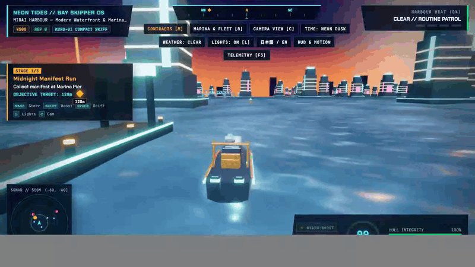
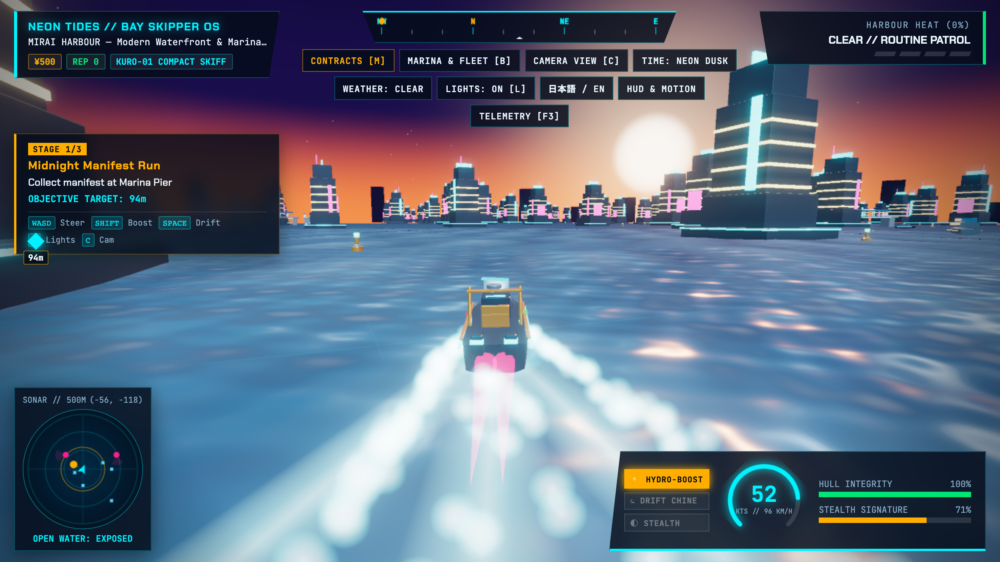
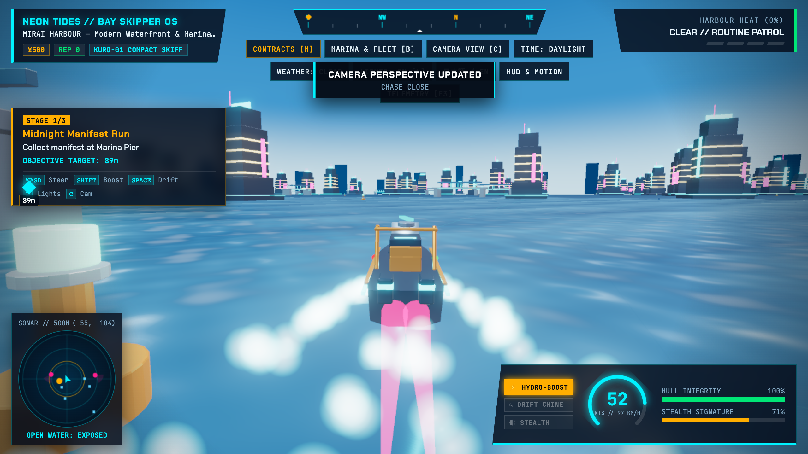
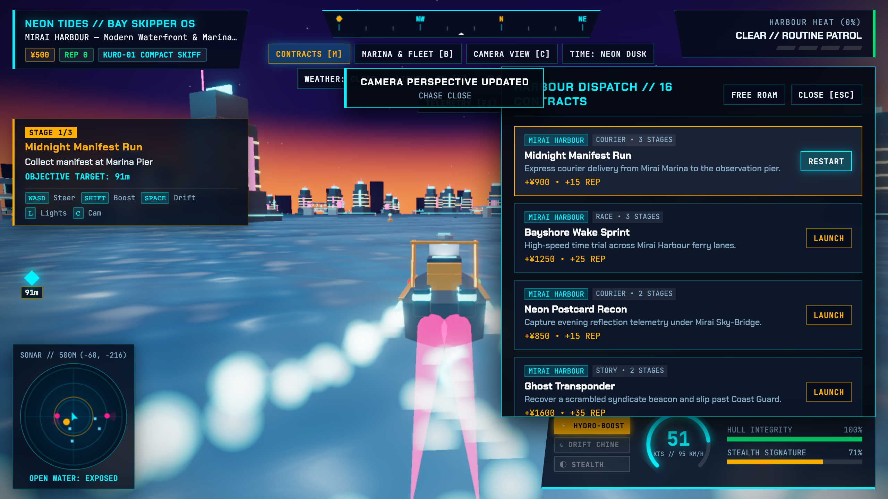
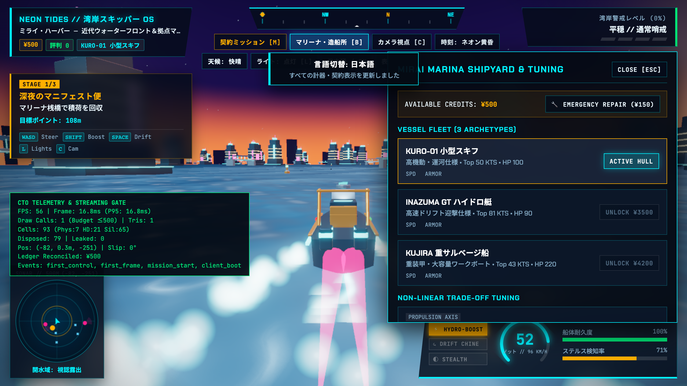
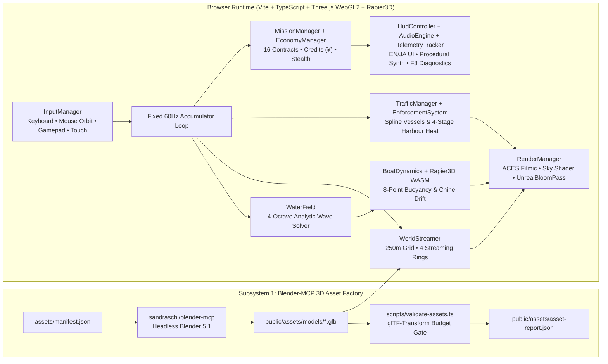

<div align="center">

# NEON TIDES // ネオン・タイズ

### **Web-First Japanese Open-World Cyber-Maritime Action & Boating Simulation**

[](https://www.typescriptlang.org/)
[](https://threejs.org/)
[](https://rapier.rs/)
[](https://github.com/sandraschi/blender-mcp)
[](./tests)

*Pilot compact cyber-skiffs, hydro-boosted GT speedboats, and armored salvage vessels across a 4×4 km fictional Japanese bay metropolis featuring neon-lit canals, container islands, dynamic Gerstner swells, 4-stage Coast Guard pursuit heat, and acoustic stealth.*

[**🎬 Watch Full HD Gameplay Video (`docs/media/gameplay.mp4`)**](docs/media/gameplay.mp4) · [**📐 System Architecture Spec**](docs/superpowers/specs/2026-10-21-neon-tides-design.md) · [**📋 Implementation Plans**](docs/superpowers/plans/2026-10-21-neon-tides-implementation-plan.md)

</div>

---

## 🎬 Live Gameplay Video & Preview

<div align="center">



<video src="docs/media/gameplay.mp4" controls muted loop playsinline width="100%"></video>

> **Full 1280×720 H.264 60fps Video:** [`docs/media/gameplay.mp4`](docs/media/gameplay.mp4) *(Click to play or download if your Markdown viewer strips `<video>` tags; inline animated preview above plays automatically on GitHub).*

</div>

---

## 📸 In-Game Screenshot Gallery

| **Neon Night — Hydro-Boost & Skyline Bloom** | **Golden Hour — Dynamic Gerstner Swell & Sunset** |
| :---: | :---: |
|  |  |
| *Cruising out of Mirai Harbour at dusk with twin hydro-jet thruster plumes, selective `UnrealBloomPass` neon signage, wake ribbons, and active mission beacon.* | *Close-action chase perspective during Golden Hour across the 4-octave Gerstner wave field with atmospheric sky dome gradients and Fresnel water speculars.* |
| **Tactical 4×4 km Bay Map & 16 Contracts (`[M]`)** | **Shipyard Upgrades (`[B]`), Japanese UI (`日本語`) & CTO Telemetry (`[F3]`)** |
|  |  |
| *Interactive 4×4 km bay radar map displaying district boundaries, player telemetry, and 16 composable launch contracts across 4 maritime districts.* | *Trade-off upgrade axes, vessel fleet switcher, instant bilingual `日本語 / EN` localization toggle, and live P95 frame/draw-call diagnostics overlay.* |

---

## 🌊 Executive Overview & Core Engineering Pillars

**Neon Tides** is an open-world maritime action game engineered from the ground up for zero-install browser execution at 60 FPS. In *Neon Tides*, **the boat is the character**: every wave crest, wake jump, chine drift, and bridge shadow directly impacts hydrodynamics, pursuit evasion, and mission execution.

1. **Deterministic 60 Hz 8-Point Hull Hydrodynamics (`src/physics/BoatDynamics.ts` + `src/core/WaterField.ts`):**
   - Shared 4-octave directional Gerstner/analytic wave solver evaluated identically on the CPU (for 8-point hull buoyancy sampling, roll/pitch restoring torque, and asymmetric keel/chine drag) and in the GPU GLSL water shader.
2. **`sandraschi/blender-mcp` Headless 3D Asset Factory (`scripts/generate-assets-mcp.py` + `scripts/validate-assets.ts`):**
   - All 10 hero boats, traffic vessels, neon towers, container cranes, bridges, and torii gates are generated headlessly via Blender 5.1 Python + `blender-mcp` against strict triangle and material budgets in [`assets/manifest.json`](assets/manifest.json) and verified via `@gltf-transform/core`.
3. **4-Ring 250 m Cell World Streamer (`src/world/WorldStreamer.ts`):**
   - Streams the `4 km × 4 km` bay (`-2000 m` to `+2000 m`) with velocity lookahead across 4 rings (`active_physics` ≤ 350 m, `high_detail` ≤ 800 m, `silhouette` ≤ 1800 m, `unloaded` > 1800 m) with deterministic memory hygiene.
4. **4-Stage Harbour Heat & Acoustic/Visual Stealth (`src/ai/EnforcementSystem.ts` + `src/gameplay/StealthSystem.ts`):**
   - Real-time signature calculation combining bow spotlight state (`[L]`), throttle acoustic load, bridge shadow cover, civilian ferry proximity, and weather visibility (`clear`, `rain`, `fog`, `storm`).
5. **Cyber-Maritime Neo-Noir Bilingual HUD & Procedural Web Audio (`src/ui/HudController.ts` + `src/audio/AudioEngine.ts`):**
   - Instant English / Japanese (`日本語`) localization, WCAG 2.2 AA High-Contrast & Reduced Motion sliders, and zero-dependency procedural Web Audio synthesis (engine RPM harmonics, water hull slap, Doppler police sirens).

---

## 🏗️ System Architecture



### Repository Structure

```text
boat-race/
├── assets/
│   └── manifest.json                  # Contract budgets (LOD triangles, materials, scale) for 10 3D assets
├── docs/
│   ├── media/                         # Captured WebGL2 screenshots, H.264 MP4 video & animated GIF
│   └── superpowers/
│       ├── plans/                     # Phased engineering & media implementation plans
│       └── specs/                     # System architecture & subsystem design specifications
├── public/
│   └── assets/
│       ├── asset-report.json          # Automated glTF-Transform validation report
│       └── models/*.glb               # 10 PBR + emissive GLB models generated via Blender-MCP
├── scripts/
│   ├── generate-assets-mcp.py         # Headless Blender 5.1 procedural PBR asset generator
│   ├── validate-assets.ts             # @gltf-transform/core triangle & material budget validator
│   └── capture-media.py               # Automated Playwright + ffmpeg screenshot & gameplay video recorder
├── src/
│   ├── ai/                            # TrafficManager (Catmull-Rom splines) & EnforcementSystem (4-stage Heat)
│   ├── audio/                         # AudioEngine (Web Audio API procedural engine/water/siren synth)
│   ├── core/                          # WaterField (deterministic CPU/GPU 4-octave wave solver)
│   ├── data/                          # 16 authored multi-stage contracts across 4 districts
│   ├── entities/                      # BoatArchetypes (Kuro Skiff, Inazuma GT, Kujira Workboat)
│   ├── gameplay/                      # MissionManager, EconomyManager (Credits ¥ + Upgrades), StealthSystem
│   ├── i18n/                          # Full English (EN) & Japanese (日本語) localization dictionary
│   ├── input/                         # Unified Keyboard, Mouse 360° Orbit, Gamepad & Touch controller
│   ├── physics/                       # BoatDynamics (Rapier3D 60Hz rigid body + 8-point buoyancy)
│   ├── rendering/                     # RenderManager (Three.js WebGL2, Sky Shader, Bloom, Wake & Spray)
│   ├── styles/                        # Neo-Noir Cyber-Maritime HUD & WCAG High-Contrast stylesheet
│   ├── telemetry/                     # TelemetryTracker (P95 frame time, draw calls, structured events)
│   ├── ui/                            # HudController (Radar, Compass, Contracts Map, Shipyard, Settings)
│   ├── world/                         # WorldStreamer (250m 4-ring cells), DistrictDefinitions, AtmosphereSystem
│   └── main.ts                        # Fixed 60Hz simulation loop & subsystem orchestrator
└── tests/                             # Vitest suites covering physics, world/AI, economy, assets & media
```

---

## 🎮 Controls & Instrumentation Reference

| Input / Key | Action | Tactical / Gameplay Impact |
| :--- | :--- | :--- |
| **`W` / `↑`** | **Throttle Forward** | Engages main hydro-jet propulsion; increases wake foam and acoustic signature. |
| **`S` / `↓`** | **Reverse / Water Brake** | Decelerates rapidly or backs out of tight Akari Canal berths. |
| **`A` / `D` or `←` / `→`** | **Rudder Steer Left / Right** | Applies stern steering torque and natural hull roll into the turn. |
| **`Shift`** | **Hydro-Boost Overdrive** | Ignites magenta plasma afterburners for maximum top speed and wake-jumping trim. |
| **`Space`** | **Chine Drift / Hard Turn** | Reduces lateral keel grip (`c_lat`) to whip the hull around 90° canal corners. |
| **`L`** | **Toggle Bow Spotlight** | Cuts forward navigation spotlight to drastically reduce Coast Guard visual detection. |
| **`C`** | **Cycle Camera Mode** | Cycles `Standard Chase` → `Close Action` → `High Tactical` → `Bow Deck Action`. |
| **`T`** | **Cycle Time-of-Day** | Cycles `Neon Dusk` → `Morning Haze` → `Clear Afternoon` → `Golden Hour`. |
| **`V`** | **Cycle Weather State** | Cycles `Clear` → `Rain` → `Fog` → `Storm` (alters wave height & stealth visibility). |
| **`M`** | **Contracts & Bay Map** | Opens the 4×4 km interactive tactical radar map and 16 mission contracts. |
| **`B`** | **Marina & Fleet Shipyard** | Switch between 3 boat archetypes or equip trade-off propulsion/hull/stealth upgrades. |
| **`R`** | **Emergency Hull Repair** | Instant field hull restoration to `100%` (`-¥150 Credits`). |
| **`F3`** | **CTO Diagnostics Overlay** | Toggles real-time FPS, P95 frame time, draw calls, active streaming rings & event log. |
| **Mouse Drag** | **360° Camera Orbit** | Click and drag anywhere on the 3D viewport to orbit the camera; auto-recenters on throttle. |

---

## 🗾 Four Maritime Districts & Playable Fleet

### 1. The 4×4 km Bay Metropolis (`src/world/DistrictDefinitions.ts`)
* **Mirai Harbour (`Center / West`):** Modern port skyline, player home marina pier, neon observation towers, and commuter ferry channels.
* **Akari Canal (`North / East`):** Dotonbori-inspired compressed neon nightlife canal with low arch bridges (`bridge_span`) ideal for breaking Coast Guard line-of-sight.
* **Kōgyō Islands (`South / West`):** Reclaimed industrial container islands dominated by gantry crane arrays (`crane_kogyo`), heavy cargo tugs, and high enforcement patrols.
* **Seto Outer Islands (`South / East`):** Open-water archipelago passages featuring the offshore crimson Torii shrine (`torii_gate`), deep storm swells, and smuggling coves.

### 2. Three Playable Vessel Archetypes (`src/entities/BoatArchetypes.ts`)
* **`KURO-01 SKIFF` (`kuro_skiff`):** Agile compact cyber-skiff with ultra-responsive yaw rate, shallow draft, and quiet acoustic profile for canal infiltration.
* **`INAZUMA GT-R` (`inazuma_gt`):** High-output twin-hydrojet racing hull engineered for time trials, high-angle chine drifting, and interceptor outruns.
* **`KUJIRA HEAVY WORKBOAT` (`kujira_work`):** Reinforced industrial salvage vessel with heavy displacement stability in storm waves and high collision armor.

---

## 🚀 Quick Start & Developer Workflows

### Prerequisites
* **Node.js** `>= 20.x` and **npm**
* *(Optional, for regenerating 3D `.glb` models)*: **Blender 5.1+**
* *(Optional, for recapturing gameplay video/GIF)*: **Python 3.11+ with Playwright** & **`ffmpeg`**

### 1. Install & Run Development Server
```bash
npm install
npm run dev
```
Open `http://localhost:5173` in any modern WebGL2 browser.

### 2. Run Automated Verification Tests & Production Build
```bash
# Run all 5 Vitest suites (Physics, World/AI/Heat, Missions/Economy/i18n, Asset Pipeline, Media/Docs)
npm test

# Type-check with TypeScript and build production bundle into dist/
npm run build
```

### 3. Validate or Regenerate 3D Assets (`sandraschi/blender-mcp`)
```bash
# Validate existing GLB models in public/assets/models/ against assets/manifest.json budgets
npm run assets:validate

# Regenerate all 10 GLB models headlessly via Blender + glTF-Transform budget gate
npm run assets:generate
```

### 4. Recapture Live Gameplay Screenshots, MP4 Video & Animated GIF
```bash
npm run media:capture
```
This launches the game in headless hardware-accelerated Chrome, executes a choreographed gameplay run across time-of-day phases, camera modes, and HUD drawers, and writes fresh `screenshot-*.png`, `gameplay.mp4`, and `gameplay-preview.gif` into [`docs/media/`](docs/media/).
