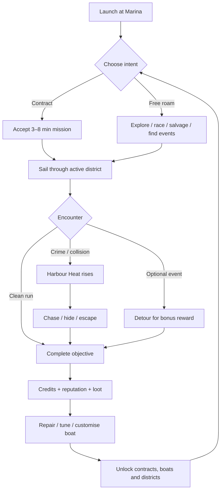
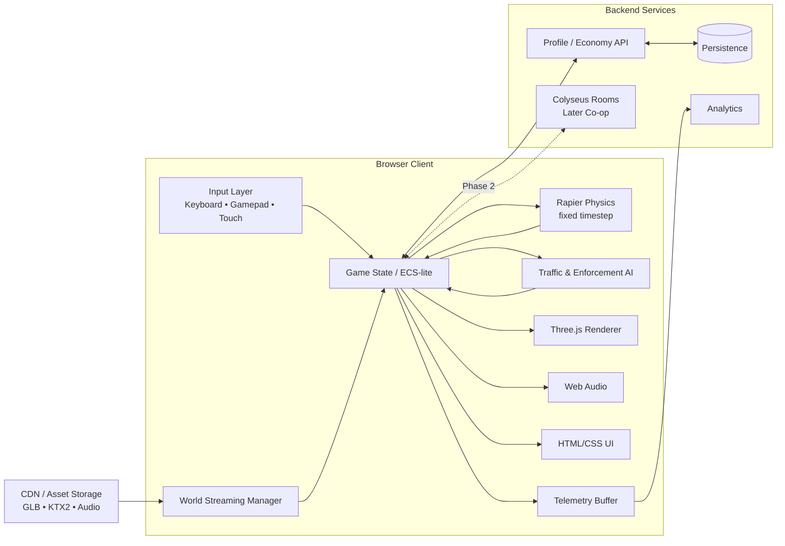

# Concept PRD: *Neon Tides* — A Web-First Japanese Open-World Boating Game

## Executive summary

**Working title:** *Neon Tides*  
**Genre:** arcade open-world boating action/adventure with crime-sandbox DNA  
**Technology:** Three.js, TypeScript, WebGL2-first; Blender + `blender-mcp` for asset production  
**Target platform:** **web-first via Three.js. Whether the eventual target is primarily mobile, desktop, or both is currently unspecified.** The recommended production assumption is desktop-class browsers as the first performance target, while keeping input, UI and asset tiers mobile-capable until device strategy is validated. Three.js's current `WebGLRenderer` requires WebGL2; Three.js also offers a newer `WebGPURenderer` that can select WebGPU when available and fall back to WebGL2. citeturn0search19turn9view4

The recommended product is not literally “GTA on water”, which would create an impossible scope comparison. It should instead capture the useful parts of that fantasy: a dense fictional city, player freedom, escalating authority response, short missions, vehicle acquisition and customisation, emergent chases, and an economy that repeatedly sends the player back into the world. Rockstar's own GTA Online material demonstrates the enduring utility of freemode, contact missions and wanted-level escalation as sandbox structures; the concept should borrow those **design principles**, not protected locations, characters, art, terminology or content. citeturn2search1turn2search28

The differentiator is that **the boat is effectively the player character**. There is no full on-foot mode in the MVP. Players pilot small Japanese-inspired speedboats, fishing craft and performance vessels through a highly compressed fictional coastal metropolis: neon canals, container docks, waterfront towers, industrial islands, fishing villages and shrine-dotted outer islands. Japan offers unusually strong visual references for this mixture: Tokyo Bay combines artificial waterfront districts and bridges; Yokohama combines a modern skyline with historic port architecture; Osaka's Dotonbori is built around a centuries-old canal and neon nightlife; and the Setouchi region contains hundreds of islands, bridges and maritime cultural landmarks. citeturn7search0turn7search1turn7search2turn7search19

The game should be **easy to start, difficult to master and highly replayable rather than coercively “addictive”**. Sessions should work at three lengths: two to five minutes for a spontaneous contract or chase, ten to twenty minutes for a progression session, and thirty-plus minutes for exploration or co-op. DREDGE is particularly instructive as a compact boating loop: its official description reduces the experience to exploring, gathering, selling and upgrading a boat. Sea of Thieves demonstrates sailing, exploration, combat and treasure hunting as a shared-world activity, while Skull and Bones explicitly builds progression around ship combat, ship builds and solo/co-operative play. citeturn3search0turn2search3turn2search5

**Core CTO recommendation:** ship a **single-player, highly polished, streamed open world first**, with asynchronous social features. Architect for but do not initially ship synchronous multiplayer. After product-market fit and boat physics are proven, add two-to-four-player co-op using a server-authoritative model. This dramatically reduces the number of systems that must be solved simultaneously: deterministic vehicle simulation, lag compensation, cheating, server operations, multiplayer mission scripting, persistence and cross-version compatibility.

The preferred technical stack is:

| Layer | Recommended baseline | Rationale |
|---|---|---|
| Rendering | Three.js `WebGLRenderer`, WebGL2 | Lowest MVP renderer risk; WebGPU abstraction can be investigated after vertical slice. Current Three.js `WebGLRenderer` uses WebGL2. citeturn0search19 |
| Physics | Rapier 3D WASM | Strong TypeScript/WebAssembly path and cross-platform deterministic JS/WASM simulation under stated conditions. citeturn4search0turn4search9 |
| Boat water interaction | Custom analytic buoyancy over shader waves | Far cheaper and more tunable than real fluid simulation. |
| Assets | GLB/glTF 2.0 + KTX2 + Meshopt/Draco where appropriate | Three.js `GLTFLoader` supports KTX2, Draco, Meshopt and glTF GPU instancing. citeturn5search1 |
| DCC | Blender automated through `sandraschi/blender-mcp` | Current repository supports headless Blender, optional live viewport sessions, GLB/glTF export, validation, modelling, materials, modifiers and batch workflows. citeturn9view0turn9view1turn9view2 |
| Multiplayer later | Colyseus authoritative rooms | TypeScript/Node-centric, with current support for fixed-timestep authoritative simulation, prediction, reconciliation and lag compensation. citeturn6search0turn9view5 |
| Audio | Web Audio API / Three positional-audio layer | Browser-native low-latency mixing and 3D panning. citeturn6search3turn6search26 |
| Content delivery | CDN + cell-based asset streaming | Keeps initial download small and allows dense visual quality where the player currently is. |

A realistic **web-first MVP is approximately eight to ten months with an average nine-to-eleven-person team**, assuming one compact open world, no on-foot gameplay and no synchronous multiplayer. Under the planning assumptions later in this PRD, a distributed experienced indie team is roughly **US$0.9m–US$1.6m** through soft launch, excluding major paid acquisition. A fuller version with co-op, considerably more content and live-ops backend is better modelled as **twelve to fifteen months and approximately US$1.5m–US$3m**, depending primarily on labour geography and content volume. These are planning estimates, not market quotations.

The decisive product risk is **not rendering technology**. It is whether a boat can provide enough expressive movement, skill, collision comedy, stealth and combat variety to sustain an open-world progression game. The first twelve weeks should therefore optimise for one question: *is moving around this harbour intrinsically fun when there is no mission marker?* If the answer is not emphatically yes, adding more city, missions or graphics will not solve the product.

## Product concept, pillars, target platforms and player loop

**Product fantasy.** The player arrives in a fictional Japanese bay city as an unknown freelance skipper. By racing, delivering cargo, salvaging wrecks, taking dubious courier jobs, helping maritime businesses, evading harbour enforcement and winning faction contracts, the player acquires increasingly specialised boats and turns a cheap marina berth into a recognisable waterfront operation.

The setting should be **Japan-inspired rather than a one-to-one reconstruction of Japan**. That gives art direction access to recognisable maritime motifs without creating expectations of geographic accuracy or making real sacred sites, police forces or communities the targets of destructive gameplay. Real references should be remixed: Odaiba-like artificial islands, Yokohama-like port skylines, Osaka-like neon canals and Setouchi-like island passages. JNTO's descriptions confirm that these references are materially distinct maritime environments rather than a generic “Japanese city” aesthetic. citeturn7search4turn7search5turn7search6turn7search19

**Target platforms.** The product requirement is **web-first through Three.js; mobile versus desktop is unspecified**. Development should therefore separate *platform commitment* from *platform compatibility*:

- The committed MVP performance target should be a recent desktop/laptop browser using WebGL2.
- Keyboard/mouse and gamepad should be first-class from the first prototype.
- Touch input should exist as an input-provider abstraction and be tested, but mobile launch should remain a gate rather than a promise until the vertical slice is profiled on representative devices.
- UI must be responsive and touch-safe even if mobile is deferred.
- Browser capability detection should select quality presets instead of maintaining separate builds.

DREDGE's developers provide a useful boating-specific touch precedent: for its mobile version they divided the display into a left navigation control and a right camera-control region, which supports the idea that independent camera and boat control can translate to touch when deliberately designed. citeturn3search6

**Core pillars.**

| Pillar | Product interpretation | Design test |
|---|---|---|
| **Joy of movement** | Turning, drifting, wake-jumping, drafting, threading narrow channels and smashing through light obstacles must be fun independently of objectives. | Would testers drive in circles for five minutes after the mission ends? |
| **Japan after dark** | The signature visual is wet water, reflected neon, bridges, port cranes, vending-machine-scale detail and skyline silhouettes. | Is a random screenshot unmistakably this game? |
| **Freedom with consequences** | Crime and reckless behaviour create escalating pursuit, while clever routing and stealth allow escape. | Can one event naturally turn into a memorable chase? |
| **Three-minute goals, thirty-hour mastery** | Contracts complete quickly, but boat collection, handling mastery, exploration and faction progression extend the horizon. | Does every session advance something without mandatory grind? |
| **Dense rather than huge** | Short travel time, continuous landmarks and frequent interactions beat a geographically enormous sea. | Is there a meaningful choice or visual event every 20–40 seconds? |
| **Spectacle within web budgets** | High perceived quality comes from art direction, water, lighting and reflections rather than brute-force scene complexity. | Does reducing geometry barely change perceived quality? |

**Tone.** Recommended tone is **stylised neo-noir exuberance**, not grim realism: midnight markets, overheard radio chatter, exaggerated harbour advertising, rainstorms, dramatic police spotlights, comic near misses and eccentric maritime contractors. Combat can exist, but gore, civilian cruelty and hyper-realistic firearm simulation would make the game more expensive to animate, moderate, localise and market without improving the central boating fantasy.

The best reference combination is not one competitor but four complementary loops. GTA Online validates open-world jobs plus an escalating wanted state; Sea of Thieves combines sailing with exploration and combat; DREDGE demonstrates an exceptionally legible “venture out → obtain value → return → upgrade” loop; and Skull and Bones uses ship builds and progression to turn naval movement and combat into long-term goals. citeturn2search1turn2search3turn3search0turn2search11

**Recommended player loop.**



The loop deliberately puts **navigation between objective selection and reward**. Fast travel should therefore be limited in the early game: once the player can teleport everywhere, the city stops producing emergent encounters. Late-game fast travel between owned marinas is acceptable because mastery has already occurred.

**Progression layers** should operate at different time scales. A single mission gives credits and consumables. Several missions purchase a tangible boat part. Several play sessions unlock a faction tier or new boat class. Long-term exploration fills collections and uncovers unique cosmetics. Seasonal content, once live ops exists, should add new contract chains and cosmetics rather than invalidate existing equipment.

**Ethical retention principle.** The desired “addictiveness” should come from skill improvement, curiosity, short goals, systemic surprises, collections and self-expression. Avoid punitive daily streak resets, intentionally confusing currencies, paid power and excessively random reward schedules. The retention design should make players think “one more run because I have an idea”, not “one more run because the game threatens to remove something”.

## Gameplay systems and world design

**Boat handling — recommended choice: arcade simulation with believable inertia.** Boats should not handle like cars pasted onto water, but fully physical marine simulation is unnecessary. Each boat should have a handful of readable attributes: acceleration, top speed, turn response, drift/slip, stability, hull strength and cargo capacity. Underneath, a Rapier rigid body receives thrust, lateral drag, angular damping and buoyancy forces from approximately four to eight hull sample points. Rapier supports standard rigid bodies, colliders, joints and scene queries suitable for this layer. citeturn4search6turn4search7turn4search12

Player-facing control should be simpler than the simulation: throttle/brake/reverse, steering, boost or engine trim, handbrake-like “hard turn” behaviour, camera and one contextual action. Damage should impair steering, engine power or hull integrity rather than simulate dozens of components.

Three initial archetypes are enough:

| Boat | Handling fantasy | Gameplay role |
|---|---|---|
| Compact skiff | Agile, cheap, easy to thread through canals | starter/exploration |
| Performance speedboat | Fast, drifts dramatically, low cargo | races/chases |
| Utility fishing/work boat | slower, stable, strong hull, high capacity | salvage/cargo/combat |

Later content can add hydrofoils, police interceptors, luxury cruisers and eccentric experimental craft.

**Missions — recommended choice: modular mission grammar plus authored signatures.** Purely bespoke missions make content too expensive; purely procedural contracts quickly feel generic. The system should compose mission stages such as `go_to`, `collect`, `follow`, `avoid_detection`, `race`, `deliver`, `destroy_or_disable`, `escape_heat`, `photograph`, `salvage` and `return`. Designers then hand-author location combinations, dialogue, complications and set pieces.

MVP mission families should be courier runs, races/time trials, salvage/diving-drone recovery, illicit delivery, pursuit/escape, harbour sabotage and faction story missions. Fishing can be a low-stress optional economy activity rather than the central game.

**Traffic AI — recommended choice: route graph, not generic navigation.** Open water does not require expensive navmesh reasoning. Author lanes, canal splines, ferry lines and harbour approach paths. Distant traffic is kinematic and decorative; only boats within an interaction radius receive full avoidance and collision bodies. This is one of the largest CPU savings available.

Traffic should have behavioural tags—commuter ferry, fisherman, taxi boat, cargo tug, leisure craft, enforcement—driving speed, route preference and reaction to the player. A lightweight local avoidance layer can predict short-horizon collisions and steer away without running full pathfinding every frame.

**Police/enforcement — recommended choice: four-stage “Harbour Heat”, not a GTA-style star clone.**

| Heat | Behaviour |
|---|---|
| Clear | routine patrols ignore player |
| Alert | local patrol investigates reported zone |
| Pursuit | interceptors chase; checkpoints appear on major channels |
| Lockdown | fast interceptors, helicopter/spotlight analogue and coordinated cut-offs |

Heat is gained through witnessed crimes and dangerous collisions, not arbitrary hidden rules. It decays when the player breaks line of sight and reduces acoustic/visual signature. At high heat, hiding in a tiny alley indefinitely should fail; enforcement expands a search grid.

Rockstar's use of removable wanted levels and wanted-state mission controls demonstrates how pursuit can act as a reusable layer across open-world mission structures rather than a one-off mission script. citeturn2search4turn2search22

**Stealth — recommended choice: maritime signature stealth.** Do not attempt character-stealth systems. A boat exposes three signatures: visual visibility, engine noise and enforcement awareness. The player can cut lights, idle the engine, enter rain/fog, move underneath bridges, hide among traffic or temporarily spoof transponders. A minimap search cone gives the player enough information to make escape strategic rather than random.

This stealth system reuses world features already required for atmosphere—fog, rain, bridges, alleys, marinas—and therefore has unusually favourable feature economics.

**Combat — recommended choice: stylised vehicle combat, deliberately shallow at MVP.** Combat should support chases without becoming a naval artillery simulator. A forward weapon, limited secondary gadget and ramming are enough initially. Candidate gadgets include flare/decoy launchers, shock mines and temporary engine-disruption devices. Projectiles should be pooled and deterministic where practical.

Targets should primarily be hostile vessels, drones or infrastructure explicitly marked as mission targets. Civilian destruction should create heat and cost rather than rewards. Avoid boarding combat in MVP: boarding immediately implies humanoid locomotion, animation, cover systems, interiors, weapons, AI navigation and camera changes.

**Economy.** Use one ordinary earnable currency at launch. Credits pay for repair, boat purchase, performance parts, utility modules and cosmetic customisation. Keep currencies legible.

Upgrade axes should create **build choices**, not just linear percentage increases:

- acceleration versus top speed;
- grip/stability versus high-slip drift handling;
- armour versus weight;
- stealth exhaust versus raw power;
- cargo capacity versus manoeuvrability;
- gadget slots versus passive bonuses.

Skull and Bones explicitly emphasises ship choice, weapons/builds and progression, showing why vessel configuration can support a wider progression loop than simply unlocking ever-faster vehicles. citeturn2search17turn2search11

**Multiplayer recommendation.** The MVP should be **single-player plus asynchronous competition**: race ghosts, leaderboards, weekly community objectives and shared photo challenges. Synchronous multiplayer is Phase Two.

The first synchronous mode should be two-to-four-player private or matchmade co-op, not a 20-player persistent city. Sea of Thieves' shared-world design and Skull and Bones' solo/group model demonstrate the appeal of social naval play, but they also represent substantially larger networking and operations commitments than this web-first MVP should absorb. Skull and Bones currently advertises solo/team play in a world containing up to 20 players, which is useful as a design reference but not an appropriate first technical target. citeturn2search3turn2search5

| Multiplayer option | Strength | Cost/risk | Recommendation |
|---|---|---|---|
| Single-player only | fastest production; deterministic local experience | limited social virality | **MVP foundation** |
| Async ghosts/leaderboards | strong race retention at low server cost | little direct social interaction | **MVP** |
| 2–4 player co-op instances | social missions and emergent chases | prediction/state sync/content complexity | **first major update** |
| 8–16 player free-roam | strong sandbox fantasy | authority, bandwidth, abuse, hosting and design complexity | later only |
| Peer-to-peer | lower server simulation cost | host advantage, NAT/connectivity and cheat authority issues | avoid for core simulation |
| Dedicated authoritative server | secure rules and predictable persistence | operating expense and netcode work | recommended for synchronous play |

WebRTC supports direct browser-to-browser arbitrary data communication, while WebSocket provides a persistent browser-to-server duplex connection. For an economy-bearing open world, server authority is preferable to trusting a peer host. citeturn6search2turn6search6

**World scale.** “Open world” should mean continuous freedom, not geographic acreage. Recommended MVP geometry is approximately **4 × 4 km of effective playable water/shoreline**, compressed so the fastest boat can cross the primary basin in roughly three to four minutes. A later v1 can extend the navigable footprint towards six to eight kilometres across while maintaining separate streamed cells.

The world should use three dense MVP macro-districts plus low-cost connective water:

| Fictional district | Visual inspiration | Gameplay function |
|---|---|---|
| **Akari Canal** | Osaka/Dotonbori-like narrow canal, bridges, signs, nightlife | tight racing, pursuit, deliveries |
| **Mirai Harbour** | Yokohama waterfront/modern port | marina, shops, starter missions, skyline |
| **Kōgyō Islands** | Tokyo Bay reclaimed/industrial waterfront | container cranes, illegal races, salvage, enforcement |
| **Outer islands** | Setouchi maritime landscape | exploration, fishing, shrines, storms; partially MVP, expanded later |

Dotonbori's defining relationship between entertainment frontage and its canal is documented by JNTO, while Yokohama's Minato Mirai is explicitly a modern international port district. Tokyo Bay's Odaiba waterfront and Rainbow Bridge create another strong urban-water silhouette. citeturn7search2turn7search1turn7search4

Outer-island composition can borrow from Setouchi's many islands and bridges and from the powerful silhouette of an offshore torii, but sacred architecture should be fictionalised and culturally reviewed. Itsukushima's gate and shrine genuinely occupy a maritime/tidal setting, which is why that visual motif feels organically linked to water rather than pasted onto a map. citeturn7search11turn7search23

**Landmarks.** Every district needs a visible anchor: an illuminated suspension bridge, observation tower, ferris-wheel silhouette, giant harbour market roof, elevated expressway, container crane array, offshore gate and mountain silhouette. Players should be able to navigate by landmark before opening the map.

**Day/night.** Use a continuous clock but art-direct it around four aggressively authored states: morning haze, clear afternoon, golden hour and neon night. Full physically accurate celestial simulation is unnecessary. The crucial transition is dusk, because illuminated signs and water reflections are a primary product screenshot.

**Weather.** MVP weather states: clear, rain and fog; storm becomes an alpha/beta stretch goal. Weather affects more than visuals: rain lowers visibility and improves stealth, fog modifies enforcement acquisition distance, and storms increase wave amplitude and create high-value contracts.

**Water rendering and physics.** Separate the two systems completely:

- Visual water: camera-centred tiled plane or low-frequency mesh, animated normals, several analytic wave components, Fresnel reflection, environment reflection and local foam/wake effects.
- Physical water: deterministic analytic height/normal function sampled by boat buoyancy points.
- Shore interaction: cheap collision volumes rather than physical shoreline fluids.
- Wakes: trail geometry/particles and decal-like foam, not simulated water displacement.
- Rain: screen-space streaks plus low-cost local splashes.
- Reflections: environment probes/cubemaps plus selective planar/reflection tricks in showcase areas; avoid universal screen-space or ray-traced reflections in MVP.

This creates the *appearance* of rich water without solving hydrodynamics.

## Art direction and the `blender-mcp` asset pipeline

The asset strategy should treat `blender-mcp` as an **automation layer over a disciplined Blender pipeline**, not as an autonomous “generate final art” button. The current repository runs most tools through headless Blender, has an optional live bridge for viewport feedback, can emit `.glb`/`.gltf` and other common formats, and exposes tools for meshes, materials, transforms, modifiers, validation, rendering and batch processing. Its roadmap also lists completed GLTF/GLB export, viewport screenshotting, mesh editing, generative backends and geometry validation. citeturn9view0turn9view1turn9view2

That makes it particularly useful for **repeatable production operations**: generating blockouts, applying naming rules, creating LOD variants, decimating secondary assets, assigning material presets, UV checks, turntable rendering, asset validation and batch export.

**Visual style.** “High graphic” should mean **high perceived fidelity**, not photorealism. The recommended style is stylised PBR:

- realistic material response;
- simplified silhouettes and geometry;
- strong colour scripting;
- wet surfaces and emissive signage;
- slightly exaggerated water and wake response;
- selective high-resolution hero assets;
- limited small geometric clutter, represented by atlases, decals and instancing.

This plays to web constraints. It also avoids the uncanny gap where photorealistic materials expose every low-budget animation, environment and lighting shortcut.

**Recommended asset-generation pipeline.**

```text
Art brief / reference board
        ↓
Structured asset specification
(scale, pivot, poly budget, materials, LODs, collision, tags)
        ↓
blender-mcp
  • blockout / mesh creation
  • transforms and modifiers
  • material assignment
  • UV operations
  • decimation / LOD generation
  • optional live screenshot review
        ↓
Artist review in Blender
        ↓
Validation
  • naming
  • normals
  • manifold / geometry checks
  • UV coverage
  • material count
  • triangle count
        ↓
GLB export
        ↓
Post-export optimisation
  • prune / deduplicate
  • join where appropriate
  • Meshopt or Draco
  • KTX2/Basis textures
        ↓
Automated in-browser visual/performance test
        ↓
CDN asset bundle
```

`blender-mcp`'s current documentation describes PBR-material operations, modifiers including decimation, UV workflows, physics, and glTF/GLB export. Its headless mode is explicitly positioned for batch export and CI/agent workflows, while the live bridge enables viewport screenshots when human visual inspection is valuable. citeturn9view0turn9view2

**Asset specification contract.** Every production asset should have machine-readable metadata beside its `.blend` source:

```text
asset_id
category
world_scale_m
pivot_policy
lod_triangle_targets
materials_max
texture_set
collision_type
streaming_cell
instancing_group
night_emission_variant
destructible_level
export_profile
```

The important CTO principle is that an AI-assisted asset pipeline must produce **testable artefacts**. A prop that looks good but has six unique 4K materials and an arbitrary pivot is a failed build.

**LOD recommendations.**

| Asset type | LOD0 target | LOD1 | LOD2 / far | Texture guidance |
|---|---:|---:|---:|---|
| Player hero boat | 40k–70k tris | ~50% | ~15–20% | 2K main atlas; selective extra decals |
| Traffic boat | 15k–30k | ~40% | 5–10% | 1K–2K atlas |
| Large landmark | 30k–80k visible | ~40% | silhouette mesh | 2K tiled/atlas materials |
| Building module | 5k–20k | ~40% | box/silhouette | shared district atlas |
| Medium prop | 1k–8k | ~35% | billboard/cull | 512–1K |
| Small clutter | <1k | instance | cull early | shared atlas |

These are **starting budgets to profile**, not engine limits.

Three.js has a built-in `LOD` object that selects meshes by camera distance, and its `InstancedMesh` is specifically intended to reduce draw calls when many objects share geometry/materials. Those should be foundational tools for lamp posts, bollards, vending machines, buoys, railings, containers and vegetation. citeturn5search0turn0search11

Avoid a single world-sized instance batch: spatially partition instance groups by streaming cell so distant cells can be unloaded and frustum-culling remains useful. glTF-Transform similarly notes that instancing is useful for repeated objects but that large prebuilt batches can reduce fine-grained frustum culling, making collocated batches preferable. citeturn11search8

**Materials and atlases.** Use a small family of PBR master materials: painted metal, wet concrete, glass, plastic/signage, wood, asphalt, water-adjacent grime and emissive signage. Pack metallic/roughness/occlusion where the glTF workflow permits. Buildings should use tiling materials plus trim sheets and decal atlases rather than unique unwraps for entire façades.

The glTF format is designed as a runtime/transmission format, and current Three.js `GLTFLoader` directly supports extensions including KTX2/Basis textures, Draco mesh compression, Meshopt compression and GPU instancing. citeturn5search1turn0search17

**Texture compression.** KTX2/Basis should be the default production target for 3D textures. Three.js's `KTX2Loader` can transcode Basis Universal textures to a GPU-supported compressed format, while Khronos positions KTX2/Basis as a way to reduce transfer size and GPU-memory requirements across GPU platforms. citeturn0search8turn0search3

Use ETC1S-style compression for many colour/material maps where compactness is more valuable, and higher-quality UASTC-like paths for normal/data maps where artefacts are obvious. Maintain PNG/TIFF/etc. originals in source control or asset storage; KTX2 is a delivery artefact.

**Geometry compression.** Prefer Meshopt for most environment assets after testing decode/load behaviour; use Draco selectively when smallest possible transfer is materially useful. Compression should be one of the *last* pipeline operations. glTF-Transform warns that compression itself does not improve runtime frame rate: geometry and draw-call reduction still require simplification, joining or instancing. citeturn11search3turn11search7

A strong automated post-export pipeline is therefore:

`inspect → prune → deduplicate → flatten safe hierarchies → join compatible static primitives → reorder → quantise → geometry compression → KTX2 texture compression → glTF validate`.

glTF-Transform provides CLI/API operations for optimisation, Meshopt, Draco, KTX2/Basis texture workflows and model inspection, making it a natural complement to Blender rather than trying to force all delivery optimisation into the DCC file. citeturn11search0turn11search2

**Asset acceptance gates.** CI should reject assets exceeding class-specific material counts, texture dimensions, triangle budgets or bounding-size constraints. It should also produce a thumbnail, triangle count, material count, decoded texture estimate and compressed file size for review.

The production metric that matters is not “assets created per day”; it is **approved reusable asset sets per artist-week that remain inside runtime budgets**.

## Technical architecture and performance budgets

The game client should behave more like a small engine built on Three.js than a single giant Three.js scene script. Rendering, gameplay, physics, world streaming, audio, input, UI, save/persistence and networking must have explicit ownership.



**Scene management.** Do not put the complete world under one permanently resident `THREE.Scene` hierarchy. Divide it into a grid of world cells, for example 250–500 metres each, with several rings:

- active physics/AI ring;
- high-detail render ring;
- low-detail skyline ring;
- unloaded region.

Each cell owns meshes, instances, collisions, traffic spawn nodes, audio emitters and mission hooks. Streaming is driven by predicted player movement, not just current position, so fast boats do not reach an unloaded shoreline.

The renderer should expose performance telemetry from day one. Three.js renderer information exposes statistics useful for monitoring rendering and GPU-resource behaviour, making draw-call/triangle/texture regressions straightforward to capture during automated performance runs. citeturn8search0turn8search2

**Fixed simulation loop.** Physics and core gameplay should run at a fixed timestep, initially 60 Hz on desktop, with rendering interpolated independently. If later mobile profiling requires 30 Hz physics for some AI objects, the player boat can remain at a higher simulation frequency. Never make steering or drag frame-rate dependent.

Rapier's JavaScript/WASM version documents cross-platform deterministic behaviour when the initial state, operation ordering and timestep are consistent; that is particularly useful if the future multiplayer stack shares the same movement function between server and client. citeturn4search0

**Physics options.**

| Engine | Characteristics | Trade-offs | Decision |
|---|---|---|---|
| **Rapier 3D** | WASM/TypeScript bindings, rigid bodies, colliders, queries, joints; JS/WASM determinism documented. citeturn4search0turn4search12 | WASM boot payload; custom boat forces still required | **Recommended** |
| cannon-es | Lightweight JavaScript 3D physics engine with a simple web-oriented API. citeturn4search1 | excellent prototype simplicity; weaker reason to select it once deterministic networking becomes important | prototype alternative |
| Ammo.js | Emscripten port of Bullet with rigid/vehicle/soft-body heritage. citeturn4search2 | generated Bullet-style API adds integration complexity for a deliberately small game | not recommended |
| Custom physics | smallest possible bespoke implementation | collisions, stability and debugging become your engine problem | use only for water forces, not all collisions |

**Boat simulation model.** Rapier should own collision integration; a custom `BoatDynamics` system owns:

1. query analytic water height/normal at hull sample points;
2. calculate submerged depth;
3. add upward buoyancy impulse;
4. apply forward thrust at motor position;
5. apply longitudinal and lateral hydrodynamic drag;
6. apply angular damping;
7. scale parameters by damage and upgrade configuration.

The wave function should be deterministic and shared between visual/physical systems. The visual shader can add higher-frequency detail not present in physics.

**Renderer decision.** Use `WebGLRenderer` for MVP unless the first month of prototyping demonstrates a clear reason to switch. Three.js describes `WebGPURenderer` as its newer renderer and currently gives it a WebGPU backend with WebGL2 fallback. That makes it strategically attractive, but it is unnecessary to bet MVP delivery on a renderer migration purely for novelty. citeturn9view4

Create a narrow internal rendering abstraction around environment setup, material creation, water, shadows, post effects and scene registration so a future WebGPU investigation does not require rewriting gameplay.

**Lighting.** One shadow-casting sun/moon directional light, baked/lightmapped or emissive façade contribution, a very small number of nearby dynamic lights and fake emissive bloom are preferable to hundreds of shadowed point lights. Neon should primarily be material emission plus cheap local illumination proxies.

Use post-processing sparingly: tone mapping, restrained bloom, colour grading and optional FXAA/TAA-style solution. Depth-of-field, SSR and expensive volumetrics should be photo-mode/high preset features rather than gameplay dependencies.

**Networking architecture.** When co-op arrives, use **server authority over mission state, economy, health/damage and authoritative boat state**. Clients predict their own boat and interpolate others. Colyseus is a strong fit because it is a Node.js authoritative-game-server framework with state synchronisation and matchmaking, and its current netcode supports fixed-timestep authoritative simulation, local prediction, reconciliation, remote smoothing and rewind-style lag compensation. citeturn6search0turn9view5

Nakama is the alternative if the organisation wants a broader integrated backend—authentication, storage, social systems and authoritative matches—rather than a lighter TypeScript-centric game-room framework. Nakama's own documentation distinguishes authoritative server matches from relayed multiplayer and recommends authority where central state and anti-cheat matter. citeturn6search1turn6search17

| Network stack | Benefits | Costs | Fit |
|---|---|---|---|
| **Colyseus** | TS/Node alignment, rooms, sync, current prediction APIs | still requires hosting, persistence design and deterministic gameplay discipline | **best co-op fit** |
| Nakama | wider backend feature set and authoritative runtime | more platform/backend surface area | use if social/meta backend becomes large |
| Custom WebSocket | maximum control | team owns matchmaking, replication, prediction, reconnection and tools | unjustified MVP cost |
| WebRTC P2P | direct peer data paths | host authority/security/connectivity complexity | voice or experiments, not core economy |

**Audio.** Use Web Audio for engine loops, water, impacts, sirens and layered music. `PannerNode` represents spatial position/orientation and is designed for 3D spatialisation, while Web Audio provides precise playback and mixing capabilities appropriate to games. citeturn6search3turn6search7turn6search26

Audio optimisation matters as much as visuals. Do not instantiate a spatial audio node for every decorative source. Use virtualisation: only the most relevant nearby emitters become active voices. Engines should use layered loops—idle, load, high RPM, wake—and cross-fade by simulation state instead of dozens of unique recordings per throttle point.

**Input.** Create action-based mapping rather than reading keys directly: `steer`, `throttle`, `brake`, `boost`, `gadget`, `interact`, `camera_x`, `camera_y`, `map`. Keyboard/mouse, controller and touch each implement that interface. This is essential because the platform split is intentionally unresolved.

**Workers.** AI route planning, world-cell preparation, analytics batching and heavy parsing are candidates for Web Workers. Moving rendering to `OffscreenCanvas` should be treated as an optimisation experiment, not an MVP assumption: browsers support worker-based canvas use and Three.js can operate with an offscreen canvas, but worker rendering introduces additional integration constraints. citeturn8search1

**Performance budgets.** These are product requirements to validate through profiling, not claims about what Three.js guarantees.

| Metric | Desktop-first target | Provisional mobile feasibility target |
|---|---:|---:|
| Gameplay frame rate | 60 fps | 30 fps minimum |
| Frame budget | 16.7 ms | 33.3 ms |
| Main-thread game + AI, P95 | ≤ 6–8 ms | ≤ 12 ms |
| Physics, P95 | ≤ 2 ms | ≤ 4 ms |
| GPU frame, P95 | ≤ 12–13 ms | ≤ 25 ms |
| Typical draw calls | ≤ 500; hard-review >700 | ≤ 250–300 |
| Visible triangles | ~1.0–1.8m target | ~400k–750k |
| High-detail dynamic boats | ~12–20 nearby | ~6–10 nearby |
| Active compressed texture working set | target ≤ 250–350 MB | target ≤ 100–150 MB |
| JS heap steady state | target ≤ 300 MB | target ≤ 180 MB |
| Initial app shell | ≤ 8–10 MB compressed | same |
| First-playable total transferred | ≤ 25–35 MB | ≤ 20–25 MB |
| Streamed district package | ~20–40 MB each | lower-resolution tier |
| Startup-to-control on good broadband | aspirational <10 s after cache warm | device/network dependent |

Texture working-set figures must be measured after GPU transcoding, not inferred from `.ktx2` download size. KTX2 is useful precisely because compressed transfer size and GPU-compatible storage are different concerns. citeturn0search3turn0search8

**Dynamic quality scaler.** On launch, benchmark the first 1–2 seconds or infer capability conservatively, then select low/medium/high. Runtime adaptation can adjust resolution scale, shadow resolution/distance, reflections, particles, vegetation/clutter range and traffic density. Avoid changing core physics or mission difficulty based on graphics tier.

**Resource disposal is a product requirement.** World streaming only works if geometries, textures, materials and render targets are explicitly released when cells leave memory. Three.js objects such as textures and render targets provide disposal semantics; GLTFLoader also warns that image bitmaps require special disposal handling. citeturn8search9turn8search6turn5search1

## MVP, roadmap, team and cost

The MVP should prove **boat feel, world density, progression and technical streaming**, not every bullet in the long-term fantasy.

**Feature prioritisation.**

| Feature | MVP | Post-MVP / later | Reason |
|---|---|---|---|
| Core boat physics | **Yes** | additional boat classes | product foundation |
| Three distinct boats | **Yes** | 10–20+ | enough to prove progression |
| Continuous open bay | **Yes** | expanded archipelago | core fantasy |
| Three visual districts | **Yes** | 5–7+ | diversity without content explosion |
| Day/night | **Yes** | seasonal daylight changes | key art pillar |
| Clear/rain/fog weather | **Yes** | storm/typhoon events | reuses systems |
| Traffic boats | **Yes** | richer civilian ecosystem | needed for city life |
| Harbour Heat/police | **Yes** | specialist units / faction law | systemic fun |
| Mission framework | **Yes** | creator/live-ops tooling | content multiplier |
| 15–25 polished missions/contracts | **Yes** | 50–100+ | viable first progression |
| Economy/upgrades | **Yes** | deep builds/crafting | retention |
| Lightweight combat | **Yes** | advanced gadgets/boss vessels | chase variety |
| Maritime stealth | **Yes** | deeper equipment/meta | low-cost differentiation |
| Fishing/salvage side activity | light | deeper collection economy | pacing |
| Boat cosmetics | **Yes** | monetised cosmetic catalogue | identity |
| Photo mode | stretch | **Yes** | organic marketing |
| Asynchronous race ghosts | stretch | **Yes** | low-cost social layer |
| Synchronous co-op | No | **Priority post-launch** | major netcode/content cost |
| Open-world PvP | No | maybe | moderation/balance cost |
| On-foot movement | No | only if data strongly supports it | scope multiplier |
| Interiors | No | selective mission spaces | streaming/content cost |
| Full destruction | No | scripted/light destructibles | physics/performance cost |
| User mission creator | No | long-term | tooling/moderation burden |

The absence of on-foot play is perhaps the most important scope decision. Adding even a modest character mode requires character animation, rigging, locomotion, interaction, humanoid AI, indoor navigation, camera transitions, collision, stairs, doors, combat retuning and an additional content scale. It should not enter the roadmap merely because the phrase “GTA-style” was used.

**Milestone roadmap.**

| Phase | Duration | Exit criteria |
|---|---:|---|
| **Pre-production / physics prototype** | weeks 1–4 | one boat feels excellent; water shader; Rapier collision; Blender-MCP → GLB pipeline automated; target devices profiled |
| **Vertical slice** | weeks 5–12 | ~1 km² showcase district; three boats; traffic; one pursuit; five representative missions; day/night/rain; economy stub |
| **Production alpha** | weeks 13–22 | world structure complete; three districts greybox-to-art; mission system stable; progression and upgrades complete; 10–15 missions |
| **Content/feature alpha** | weeks 23–28 | 15–25 missions; full police states; stealth; economy balanced; localisation infrastructure; analytics live |
| **Beta and optimisation** | weeks 29–34 | performance budgets met on target matrix; Japanese/English content; save/persistence hardened; accessibility pass |
| **Soft launch** | weeks 35–38 | controlled web audience; retention and funnel data; crash/performance dashboards; economy tuning |
| **MVP launch** | weeks 39–42 | launch-quality content, CDN scaling, customer support and rollback processes |
| **Co-op R&D/update** | +12–20 weeks | 2–4-player authoritative sessions without compromising local boat feel |

The first hard **go/no-go gate is week 4**, not month six. Measure controls with blind playtests. The second is week 12: a polished vertical slice should demonstrate that city density and graphical ambition can coexist with browser budgets.

**Team composition.**

| Role | Typical MVP FTE | Main ownership |
|---|---:|---|
| CTO / technical director | 1.0 | architecture, performance, build, technical product decisions |
| Senior graphics/engine engineer | 1.0 | Three.js renderer, streaming, water, shaders, optimisation |
| Gameplay engineers | 2.0 | boats, missions, AI, police, progression |
| Backend/network engineer | 0.4–0.6 | accounts/save/leaderboards; co-op architecture groundwork |
| Technical artist / pipeline | 1.0 | Blender-MCP, exporters, LODs, shaders, asset CI |
| Environment/3D artists | 1.5–2.0 | modular world kits, boats, landmarks, props |
| Game designer / systems designer | 1.0 | missions, economy, handling tuning, progression |
| Producer/product lead | 0.5–1.0 | schedule, playtests, scope, live-ops planning |
| UI/UX designer | 0.5–0.75 | HUD, maps, menus, accessibility, responsive layouts |
| Audio designer/composer | 0.2–0.4 | contract/outsourced initially |
| QA | 0.5 early → 1.5 late | browsers/devices/regression/gameplay |
| Japanese localisation/cultural consultant | ~0.1–0.25 late-stage equivalent | language/cultural review |

**Average:** approximately **9–11 FTE**, with art and QA ramping over time rather than every role being full-time from day one.

A particularly effective staffing pattern is one technical artist who behaves partly as a tooling engineer. Because `blender-mcp` already provides headless batch operations, export and validation capabilities, that person should turn common artist actions into deterministic build steps rather than manually processing hundreds of files. citeturn9view0turn9view1

**Cost assumptions.** The following is an internal planning model:

- average MVP staffing: ~9.5 FTE;
- development to soft launch: ~9 months;
- therefore roughly 85 FTE-months;
- blended fully loaded FTE-month assumption: **US$8,000–US$14,000**, reflecting a distributed experienced team rather than an all-San-Francisco cost base;
- add approximately 15–20% for contractors, audio, localisation, test hardware, cloud/CDN, software and external QA;
- maintain ~15% contingency because graphical open-world games produce significant optimisation/content risk.

That yields a **practical MVP envelope around US$0.9m–US$1.6m**. A lower-cost geography with founders below market salary could come in below that; a predominantly senior US/Western-European payroll could exceed it substantially.

A **12–15 month v1 with co-op, more boats, a larger world and ongoing live operations** should be budgeted roughly **US$1.5m–US$3m** before user acquisition. Multiplayer itself is not necessarily the dominant hosting cost at small scale; the expensive part initially is engineering, QA and content complexity.

Do not materially increase art headcount before the week-12 vertical slice. It is economically better to discover that water handling or the rendering architecture is wrong with three artists than with ten.

## Monetisation, retention, live operations, QA, accessibility, localisation and risks

**Monetisation recommendation.** Monetisation should remain deliberately conservative until retention is demonstrated. The recommended model is **free-to-start with cosmetic monetisation and optional content expansion**, or a small premium/founder package if acquisition economics favour a paid product. Do not sell handling stats or combat power.

A possible web-first structure is:

- free access to the starter harbour, starter boats and a meaningful campaign slice;
- account purchase/unlock for the complete city, if premium conversion tests well;
- cosmetic hulls, decals, wake effects, marina decoration and captain identity;
- later seasonal cosmetic pass;
- paid major district/mission expansions if production economics justify them.

Do **not** launch with three premium currencies, loot boxes and a battle pass simply because those mechanisms exist elsewhere. Every monetisation system increases UI, backend, economy, QA, localisation, fraud/support and balancing cost.

**Retention structure.**

| Horizon | Player reason to return |
|---|---|
| Minutes | “one more contract / one more chase” |
| Session | afford the next meaningful engine or hull upgrade |
| Several sessions | unlock boat class or faction tier |
| Week | weekly regatta, rotating high-value contracts |
| Month | district storyline, boat collection, cosmetic set |
| Season later | new contract chain, event, boat/cosmetic theme |

DREDGE's core “sell catch → upgrade boat → reach new opportunities” structure illustrates how a small number of systems can produce a strong compounding loop without hundreds of independent mechanics. citeturn3search0

**Live operations.** Build content as data from the beginning. Mission definitions, payouts, spawn sets, traffic density, weather weights, shop inventories and progression thresholds should be remotely configurable or data-driven wherever security permits. This enables balance adjustments without rebuilding world geometry.

Recommended later cadence is modest: weekly rotating challenges, periodic cosmetic drops and larger six-to-eight-week themed events. A small team will fail if it promises MMO-scale weekly bespoke narrative.

**QA requirements.** Browser games have an unusually broad runtime matrix. QA must cover Chrome/Chromium, Safari and Firefox where supported by the final compatibility policy; OS/browser combinations; integrated and discrete GPUs; different device pixel ratios; throttled CPUs; slow/unstable networks; controller connect/disconnect; tab suspension; context loss; save migration; CDN failures and low-memory conditions.

Every world-cell bundle should have automated tests for load/unload cycles. A 30-minute “speedboat traversal test” should repeatedly cross cell boundaries while recording frame time, renderer statistics, heap growth and resource counts. The game fails the test if memory consistently rises after returning to the starting region.

Critical automated suites should include:

- deterministic physics replay/hash tests;
- mission state-machine tests;
- economy source/sink invariants;
- save-version migration tests;
- asset-budget validation;
- missing localisation keys;
- corrupted/missing streamed-cell recovery;
- input mapping tests;
- multiplayer simulation under injected latency once co-op exists.

**Telemetry.** Instrument the product before soft launch, not after. Minimum event taxonomy:

`client_boot`, `first_frame`, `first_control`, `tutorial_step`, `mission_offer`, `mission_start`, `mission_complete`, `mission_fail`, `mission_abandon`, `heat_change`, `pursuit_escape`, `boat_destroyed`, `currency_source`, `currency_sink`, `upgrade_purchase`, `boat_purchase`, `district_enter`, `secret_found`, `session_end`.

Join gameplay analytics with technical telemetry: average/P95 frame time, long-frame count, draw calls, triangles, active cell count, asset-load latency, device/browser/GPU category, disconnects and JavaScript exceptions.

Primary funnels should be:

**page load → first control → first mission accepted → first mission completed → first upgrade → second session → third session.**

Mission analytics should ask *why* players fail rather than merely count failure. Log objective state, location, damage, heat level and elapsed time at abandonment.

For economy telemetry, every currency grant and spend should carry a typed reason. If currency cannot be reconciled from events, diagnosing inflation and exploit behaviour will be unnecessarily difficult.

**Accessibility.** Target WCAG 2.2 AA for the surrounding web UI wherever applicable, while recognising that game-canvas accessibility requires additional game-specific work. W3C recommends WCAG 2.2 as the current conformance target and covers keyboard operation, contrast, controls, text alternatives and other web accessibility requirements. citeturn10search0turn10search1

Game-level requirements should include remappable controls, keyboard-only menu navigation, controller support, subtitles with speaker identification, subtitle/background sizing, independent music/effects/dialogue controls, high-contrast HUD options, non-colour-only mission indicators, scalable UI, aim/steering assistance, hold-versus-toggle settings and difficulty/accessibility assists.

**Reduced motion is especially important in a boating game.** Provide sliders/toggles for camera bob, camera shake, FOV kick, motion blur, wake-screen effects and horizon roll. Respect the browser's reduced-motion preference for UI animations where practical; reduced-motion mechanisms are specifically recommended by modern web accessibility guidance. citeturn10search5turn10search7

Do not tie mission information solely to red/green indicators. Police search status, boat damage and objectives should combine shape/icon/text/audio cues.

**Japanese and English localisation.** Both should be treated as first-class launch languages rather than translating English at the end.

All user-facing text must live outside gameplay code. UI layouts need to support Japanese CJK rendering and appropriate line breaking; fonts must include intentional Japanese glyph coverage without forcing enormous unnecessary webfont downloads. Subset fonts by required character sets where licensing permits, and test missing-glyph fallbacks in CI.

Use bilingual content IDs such as `mission.akari.courier_03.title`, never English source text as keys. Spoken dialogue can initially remain one language with bilingual subtitles if budget requires; all gameplay-critical audio information must have text equivalents.

The Japanese cultural review must extend beyond translation. Validate naming, signage, shrine/temple visual language, fictional policing, tattoos/gang associations, festivals, food branding and the treatment of sacred imagery. The safest creative approach is a fictional Japanese municipality with invented companies and institutions, supported by authentic environmental research.

**Primary risks and mitigation.**

| Risk | Probability / impact | Mitigation |
|---|---|---|
| **Boat movement is not inherently fun** | high / existential | week-4 handling gate; prototype three radically different handling models before world production |
| **“GTA-style” expands scope towards cars/on-foot/interiors** | high / existential | PRD explicitly defines boat as player character; change requires executive re-baselining |
| **Web performance misses high-graphic promise** | high / high | performance budgets from first slice; cell streaming; KTX2; instancing; LOD; dynamic resolution |
| **AI-generated/MCP assets lack consistency** | medium / high | style bible, asset schema, deterministic post-process, human art review |
| **Large downloads kill conversion** | high / high | <25–35 MB first playable target; background district streaming; compressed textures |
| **Water rendering consumes GPU budget** | medium / high | analytic water; no real fluid simulation; tiered reflection options |
| **Traffic consumes CPU** | medium / high | spline routing; kinematic distant traffic; physics only nearby |
| **Police feels unfair** | medium / high | explicit detection state/search UI; witness rules; deterministic escape mechanics |
| **Mission repetition** | high / medium | stage grammar + authored complications + district-specific routing |
| **Economy becomes grindy** | medium / high | upgrades every few missions; telemetry on earn/spend and abandonment |
| **Multiplayer destabilises roadmap** | high / high | architect interfaces now, ship synchronous multiplayer only after single-player metrics |
| **Cheating in future co-op/economy** | medium / high | server authority over economy and authoritative mission state |
| **Browser/device fragmentation** | high / medium | capability tiers; fixed support matrix; automated device lab |
| **Cultural stereotyping/IP problems** | medium / high | fictional setting; Japanese cultural consultant; legal/IP review; no direct GTA replication |
| **Live-ops demand exceeds team capacity** | medium / high | reusable mission templates; conservative cadence; remote configuration |
| **Mobile expectation becomes implicit** | high / medium | formally label mobile as uncommitted until vertical-slice device testing |

The performance mitigations are supported by the chosen stack rather than requiring bespoke technology: Three.js provides explicit LOD and instancing mechanisms; its glTF loader supports modern geometry/texture compression extensions; KTX2 targets compact GPU-ready textures; and the Blender-MCP pipeline can automate export, validation and batch processing. citeturn5search0turn0search11turn5search1turn0search8turn9view0

**Recommended green-light criteria.** At the end of the vertical slice, proceed to full production only if all of the following are true: testers voluntarily free-roam after objectives; three boat archetypes feel meaningfully different; pursuit produces repeatable unscripted stories; the showcase district sustains the target frame rate on the agreed minimum hardware; first-playable transfer size remains within budget; Blender-MCP-to-GLB production is repeatable rather than dependent on manual rescue; and at least one ten-minute session naturally contains movement, mission, economic progress and a memorable emergent event.

The strongest strategic version of *Neon Tides* is therefore **not an enormous browser GTA imitation**. It is a tightly scoped systems game whose apparent richness comes from one unusually expressive vehicle, a compressed Japanese maritime city, lighting and water that photograph well, rapidly reusable missions and a production pipeline designed around streaming and automated asset optimisation. Three.js already supplies the core rendering primitives and modern glTF extension support required for that approach, while the current `blender-mcp` project is capable of serving as an automated Blender production/export layer rather than merely an experimental modelling interface. citeturn5search1turn9view0turn9view1