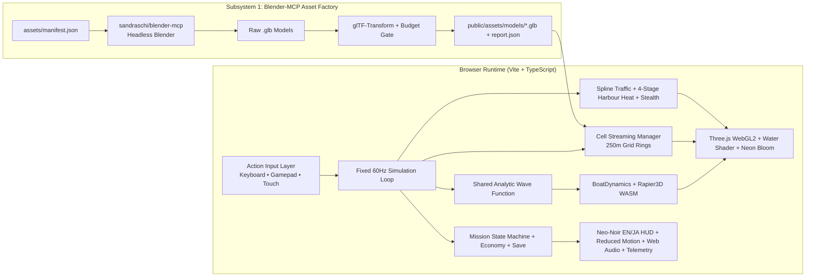

# Neon Tides — System Architecture & Phased Subsystem Specification

**Date:** 2026-10-21  
**Source PRD:** [deep-research-report.md](file:///Users/surajpandey/Documents/boat-race/deep-research-report.md)  
**Target Stack:** TypeScript, Three.js (`WebGLRenderer` WebGL2), `@dimforge/rapier3d-compat` (60 Hz deterministic WASM), Web Audio API, `sandraschi/blender-mcp` (Headless Blender 3D Asset Factory) + `@gltf-transform/core`.

---

## 1. Executive Overview & Architectural Goals

*Neon Tides* is a web-first Japanese open-world boating action/adventure game where the boat is the player character. Players pilot compact skiffs, performance speedboats, and heavy utility vessels across a compressed 4×4 km fictional Japanese bay metropolis featuring neon canals, modern port skylines, industrial container islands, and offshore torii shrines.

To satisfy the strict engineering, visual, and performance budgets in [deep-research-report.md](file:///Users/surajpandey/Documents/boat-race/deep-research-report.md), the system is decomposed into four loosely coupled, independently testable subsystems:

1. **Subsystem 1: `sandraschi/blender-mcp` Asset Factory & Validation Gate**
2. **Subsystem 2: Core Engine, Analytic Water & Rapier 60 Hz Boat Dynamics**
3. **Subsystem 3: Streamed World Grid (3 Districts + Outer Islands), Spline Traffic AI, Harbour Heat & Stealth**
4. **Subsystem 4: Modular Mission Grammar, Single-Currency Economy, Neo-Noir Bilingual HUD, Audio & Telemetry**

---

## 2. Subsystem 1: `sandraschi/blender-mcp` Asset Factory & Validation Gate

### 2.1 Architecture
Rather than treating 3D models as opaque hand-crafted files or unmanaged procedural meshes, all core 3D game assets are defined in `assets/manifest.json` with explicit engineering contracts:
- `asset_id`: unique identifier (`boat_skiff`, `boat_speedboat`, `boat_workboat`, `traffic_ferry`, `police_interceptor`, `building_akari_neon`, `crane_kogyo`, `torii_gate`, `bridge_span`, `buoy_marker`)
- `category`: `hero_boat` | `traffic_boat` | `landmark` | `building` | `prop`
- `world_scale_m`: `[length, width, height]` bounding box target in meters
- `pivot_policy`: `waterline_center` (for vessels) or `base_center` (for structures)
- `lod_triangle_targets`: `[lod0, lod1, lod2]` maximum triangle budgets
- `materials_max`: maximum distinct PBR materials per asset
- `night_emission_variant`: boolean flag for emissive neon windows/signage channels
- `collision_type`: `convex_hull` | `box` | `trimesh`

### 2.2 Integration with `sandraschi/blender-mcp`
- Vendor/clone `https://github.com/sandraschi/blender-mcp` into `tools/blender-mcp`.
- Ensure macOS Homebrew `blender` CLI binary is installed and functional.
- Create `scripts/generate-assets-mcp.py` which imports the `blender-mcp` handler modules / invokes `blender-mcp` headless operations in Blender Python to construct stylized PBR meshes, apply modifiers (bevel, array, decimate for LODs), assign metallic/roughness/emissive materials, and export `.glb` files into `public/assets/models/`.
- Create `scripts/validate-assets.ts` using `@gltf-transform/core` to inspect every exported `.glb`, prune/deduplicate primitives, verify triangle count and material count against `assets/manifest.json`, and emit `public/assets/asset-report.json`. Any budget violation fails the build.

---

## 3. Subsystem 2: Core Engine, Analytic Water & Rapier 60 Hz Boat Dynamics

### 3.1 Fixed-Timestep Simulation & Shared Wave Math
- **Simulation Tick:** Fixed `dt = 1 / 60` s (`16.667 ms`) accumulator loop with render interpolation alpha.
- **Deterministic Wave Function (`src/core/WaterField.ts`):**
  Evaluates a sum of 4 Gerstner/analytic directional wave octaves parameterized by `(x, z, time, weatherState)`.
  Returns `{ height: number, normal: Vector3 }` identically on the CPU (for buoyancy sampling) and in the GLSL vertex/fragment water shader.

### 3.2 Rapier 3D & 8-Point Hull Buoyancy (`src/physics/BoatDynamics.ts`)
- Each playable and nearby AI boat owns a Rapier dynamic rigid body and compound box/convex collider.
- **8 Hull Sample Points** (bow L/R, mid-fore L/R, mid-aft L/R, stern L/R) sample `WaterField.sample(worldX, worldZ, time)`:
  - When `submergedDepth = waterHeight - pointWorldY > 0`, apply upward buoyancy force proportional to `submergedDepth * displacement * gravity` plus vertical heave damping.
- **Hydrodynamic Forces:**
  - Forward/reverse thrust applied at the stern motor offset, scaled by throttle and engine trim/boost.
  - Asymmetric directional drag: low longitudinal drag (`c_long`), high lateral keel drag (`c_lat`) tunable by the `drift/slip` stat when engaging hard-turn/drift mode.
  - Roll/pitch restoring torque and yaw angular damping so boats lean naturally into turns and pitch over wakes without flipping uncontrollably.
- **Three Playable Boat Archetypes (`src/entities/BoatArchetypes.ts`):**
  1. **Compact Skiff (`kuro_skiff`):** High turn rate, low draft, nimble in Akari Canal alleys.
  2. **Performance Speedboat (`inazuma_gt`):** High top speed, dramatic lateral drift slip, wake-jumping trim boost.
  3. **Utility Work/Salvage Boat (`kujira_work`):** Heavy hull armor, high stability in storm swell, large cargo capacity, ramming resilience.

### 3.3 Rendering Abstraction (`src/rendering/RenderManager.ts`)
- Wraps Three.js `WebGLRenderer` (WebGL2) with ACES Filmic tone mapping, restrained emissive bloom, dynamic resolution scaling, and a camera-centered multi-LOD water mesh with Fresnel reflections, animated wave normals, and wake foam ribbon particles.
- Exposes real-time telemetry (`drawCalls`, `triangles`, `frameTimeMs`, `p95FrameTimeMs`, `texturesCount`, `geometriesCount`).

---

## 4. Subsystem 3: Streamed World Grid, Districts, Traffic AI, Harbour Heat & Stealth

### 4.1 Cell-Based World Streaming (`src/world/WorldStreamer.ts`)
- The 4×4 km bay (`-2000m` to `+2000m` on X/Z) is partitioned into `250m × 250m` streaming cells.
- **4 Streaming Rings** driven by `playerPosition + playerVelocity * lookaheadSeconds`:
  - **Ring 0 (Active Physics + AI, ≤ 350m):** Full Rapier colliders, active boat buoyancy, dynamic lights.
  - **Ring 1 (High-Detail Render, ≤ 800m):** LOD0/LOD1 meshes and per-cell `THREE.InstancedMesh` batches.
  - **Ring 2 (Skyline Silhouette, ≤ 1800m):** LOD2 low-poly silhouettes and emissive beacons.
  - **Ring 3 (Unloaded, > 1800m):** Explicit `geometry.dispose()` and `material.dispose()` with strict resource count tracking to guarantee zero memory leaks across 30-minute traversal tests.

### 4.2 Four Fictional Japanese Maritime Districts
1. **Mirai Harbour (Center/West):** Modern port skyline, player home marina & upgrade dock, observation tower, ferris wheel silhouette, wide ferry channels.
2. **Akari Canal (North/East):** Dotonbori-inspired compressed neon nightlife canal, low bridges, dense commercial signage, tight shortcuts for losing pursuit.
3. **Kōgyō Islands (South/West):** Tokyo Bay-style reclaimed industrial islands, container crane arrays, cargo docks, hazardous salvage channels, high enforcement presence.
4. **Seto Outer Islands (South/East):** Scenic archipelago passages, offshore crimson Torii gate, fishing coves, deeper wave swells, fog/storm corridors.

### 4.3 Day/Night Clock & Weather System (`src/world/AtmosphereSystem.ts`)
- Continuous 24-hour game clock art-directed around 4 key states: **Morning Haze**, **Clear Afternoon**, **Golden Hour**, and **Neon Night**.
- **Weather States (`clear`, `rain`, `fog`, `storm`):**
  - Dynamically scales wave amplitude (`WaterField`), fog density, rain streak particles, and stealth visibility multipliers.

### 4.4 Route-Graph Traffic AI, 4-Stage Harbour Heat & Maritime Stealth
- **Traffic AI (`src/ai/TrafficManager.ts`):** Commuter ferries, fishing boats, taxi skiffs, and cargo tugs follow authored Catmull-Rom canal/bay splines. Distant vessels move kinematically; vessels inside Ring 0 enable local ray/circle obstacle avoidance and Rapier collision response.
- **4-Stage Harbour Heat (`src/ai/EnforcementSystem.ts`):**
  - `0: Clear` → Routine patrols ignore player.
  - `1: Alert` → Local patrol investigates last witnessed crime/collision cone.
  - `2: Pursuit` → Fast police interceptors engage; channel blockades spawn.
  - `3: Lockdown` → Coordinated interceptor pincer routes + overhead searchlight sweep cones.
- **Maritime Signature Stealth (`src/gameplay/StealthSystem.ts`):**
  - Computes real-time `signature = f(headlightsOn, throttleNoise, weatherVisibility, underBridgeCover, trafficProximity)`.
  - Cutting lights (`L`), idling throttle under bridges or inside rain/fog shrinks patrol detection cones and accelerates Heat decay during escape.

---

## 5. Subsystem 4: Modular Mission Grammar, Economy, Bilingual HUD, Audio & Telemetry

### 5.1 Modular Mission Grammar (`src/gameplay/MissionManager.ts`)
- Data-driven mission definitions in `src/data/missions.json` built from composable stage primitives:
  - `go_to`, `collect`, `race_checkpoints`, `avoid_detection`, `deliver_fragile`, `salvage_drone`, `disable_target`, `escape_heat`, `photograph_landmark`, `return_marina`.
- **16 Authored Launch Contracts** spanning all 4 districts and mission families (Courier Runs, Neon Canal Time Trials, Illicit Night Deliveries, Industrial Salvage, Harbour Sabotage, and Faction Boss Runs), plus asynchronous personal/seeded ghost replay & leaderboards.

### 5.2 Single-Currency Economy, Upgrades & Gadgets (`src/gameplay/EconomyManager.ts`)
- Single legible earnable currency: **Credits (`¥`)** plus **Faction Reputation**.
- Every grant and spend emits a typed ledger entry (`mission_reward`, `salvage_sale`, `hull_repair`, `upgrade_purchase`, `boat_unlock`, `collision_fine`).
- **Trade-Off Upgrade Axes** (not purely linear stat inflation):
  - *Propulsion:* High-Torque Accel vs. Top-Speed Hydro-Prop
  - *Handling:* High-Grip Keel vs. Drift-Slip Chine
  - *Hull:* Reinforced Armor (+HP, +Mass) vs. Carbon Lightweight (-HP, +Speed)
  - *Exhaust:* Stealth Baffled Exhaust (-Noise Signature) vs. Open Afterburner (+Boost)
- **Combat & Escape Gadgets:** Acoustic Decoy Flare, EMP Wake Mine, Overdrive Trim Booster, Salvage Grapple.
- Versioned local persistence (`localStorage` with schema migration validator).

### 5.3 Distinctive Neo-Noir Bilingual HUD & Accessibility (`src/ui/HudController.ts`)
- **Aesthetic Direction:** *Cyber-Maritime Neo-Noir Instrumentation* — angular asymmetric phosphor-cyan & sodium-amber telemetry clusters, scanline wet-glass overlays, high-contrast Japanese/English typography, radial radar minimap showing patrol search cones and acoustic noise rings.
- **Bilingual EN / JA Localisation (`src/i18n/locales.ts`):** Instant runtime toggle between English and Japanese (`日本語`) using structured content IDs (`mission.akari.courier_01.title`) with zero hardcoded UI strings.
- **WCAG 2.2 AA & Reduced Motion:**
  - Dedicated settings drawer with sliders/toggles for Camera Bob, Horizon Roll, FOV Kick, Screen Rain Streaks, High-Contrast Mode (shape + icon + text cues for Heat/Damage, never color-only), Audio mixer (Master / Engine / Ambience / UI), and full keyboard/gamepad/touch control support.

### 5.4 Procedural Web Audio & Telemetry Buffer
- **Web Audio Synthesizer (`src/audio/AudioEngine.ts`):** Zero-external-dependency procedural Web Audio nodes for multi-layered boat engine RPM/load synthesis, hull water slap, rain hiss, police siren Doppler panning (`PannerNode`), UI clicks, and synthwave night ambience.
- **Telemetry Buffer (`src/telemetry/TelemetryTracker.ts`):** Captures all required PRD events (`client_boot`, `first_frame`, `first_control`, `mission_start`, `mission_complete`, `heat_change`, `currency_source`, `currency_sink`, etc.) plus P95 frame/physics/draw-call diagnostics inspectable in an in-game CTO Diagnostics Overlay (`F3`).
